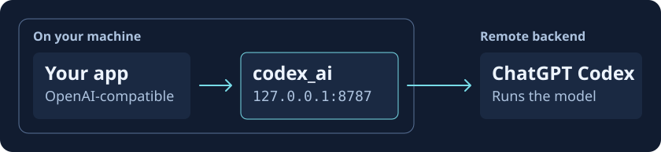

# codex_ai

**Use ChatGPT Codex from an OpenAI-compatible client.**

Point your script, SDK, or app at `http://127.0.0.1:8787/v1` to list your
account's Codex models and generate responses without a separate OpenAI API key.

[Homebrew](#getting-started-with-homebrew-macos) · [Cargo](#getting-started-with-cargo-macos-linux-and-windows-rust-189) · [API examples](#calling-the-api) · [GitHub Releases](https://github.com/bbrangeo/codex_ai/releases) · [MIT License](LICENSE)



> [!IMPORTANT]
> **The gateway runs locally; the models do not.** Prompts, conversation history,
> and tool results you send are forwarded to ChatGPT Codex. You need an internet
> connection and a ChatGPT account with Codex access. Model availability and
> usage limits come from that account.

## Getting started with Homebrew (macOS)

**1. Install with Homebrew.** This repository hosts the
[formula](Formula/codex-ai.rb). Give Homebrew the repository URL when adding the tap:

```sh
brew tap bbrangeo/codex-ai https://github.com/bbrangeo/codex_ai.git
brew trust --formula bbrangeo/codex-ai/codex-ai
brew install bbrangeo/codex-ai/codex-ai
brew test bbrangeo/codex-ai/codex-ai
```

`brew trust` approves only this formula. Skip that line if your Homebrew version does not have the command. `brew test` checks the launcher and its environment file in a temporary directory, without a ChatGPT account.

**2. Configure and sign in.** Run `codex-ai-service --help` to create
`~/.config/codex_ai/env` with `0600` permissions. Generate a local key with
`openssl rand -hex 32` and set `CODEX_API_KEY` in that file. You can also set
`CODEX_LISTEN` (default: `127.0.0.1:8787`) or `CODEX_DEBUG=1`.

**Set the key in this file, not just in your terminal.** On macOS, `brew services`
starts the gateway through `launchd`, so it does not inherit an
`export CODEX_API_KEY=...` from your current shell.

Stop any existing gateway process, then run:

```sh
codex-ai-service login
```

Open the displayed URL in a browser **on the same machine** and complete sign-in.

**3. Start the gateway** without `sudo`:

```sh
brew services start bbrangeo/codex-ai/codex-ai
```

Homebrew restarts the service at login. To run in the foreground **instead**, use
`codex-ai-service serve`.

Already installed? See [Homebrew maintenance](#homebrew-maintenance) for service
commands, upgrades, and switching taps.

## Getting started with Cargo (macOS, Linux, and Windows; Rust 1.89+)

From a checkout of this repository, sign in:

```sh
cargo run --locked -- login
```

Open the displayed URL in a browser **on the same machine** and authorize the sign-in. The OAuth callback uses port `1455`, or `1457` if the first port is in use. Then start the server. On macOS and Linux:

```sh
export CODEX_API_KEY="$(openssl rand -hex 32)"
cargo run --locked -- serve
```

On Windows, set the local key in PowerShell instead:

```powershell
$key = New-Object byte[] 32
$rng = [System.Security.Cryptography.RandomNumberGenerator]::Create()
$rng.GetBytes($key)
$rng.Dispose()
$env:CODEX_API_KEY = [Convert]::ToBase64String($key)
cargo run --locked -- serve
```

## Calling the API

| Client setting | Value |
| --- | --- |
| Base URL | `http://127.0.0.1:8787/v1` |
| API key | Your local `CODEX_API_KEY` (not an OpenAI API key or an OAuth token) |

The `curl` examples need that same key in the shell that runs them.

<details>
<summary>Load the key from your Homebrew environment file</summary>

If you trust the contents of the file, load it in a POSIX shell:

```sh
set -a
. "$HOME/.config/codex_ai/env"
set +a
```

</details>

### List available models

```sh
curl -fsS http://127.0.0.1:8787/v1/models \
  -H "Authorization: Bearer $CODEX_API_KEY"
```

### Generate a response

Replace `MODEL_ID` with an `id` returned by `/v1/models`.

```sh
curl -fsS http://127.0.0.1:8787/v1/responses \
  -H "Authorization: Bearer $CODEX_API_KEY" \
  -H 'Content-Type: application/json' \
  -d '{"model":"MODEL_ID","input":"Say hello."}'
```

### Use Chat Completions instead

Send the same prompt in a `messages` array:

```sh
curl -fsS http://127.0.0.1:8787/v1/chat/completions \
  -H "Authorization: Bearer $CODEX_API_KEY" \
  -H 'Content-Type: application/json' \
  -d '{"model":"MODEL_ID","messages":[{"role":"user","content":"Say hello."}]}'
```

> [!TIP]
> Both generation endpoints return JSON by default. To stream events, add
> `"stream": true` to the request and use `curl -N`.

## Supported API endpoints

| Endpoint | Behavior |
| --- | --- |
| `GET /v1/models` | Lists models visible in your Codex account's catalog. |
| `POST /v1/responses` | Generates responses as JSON or SSE (`stream: true`). Native Responses items and tools are forwarded to Codex, subject to backend support. |
| `POST /v1/chat/completions` | Returns text, `function` tool calls, and usage as JSON or SSE. For images and other tool types, use Responses. |

## How it works

1. **Sign in.** `login` prints a URL for you to open in your browser. The gateway
   caches the OAuth tokens locally and uses them to authenticate with Codex.
2. **Connect to localhost.** `serve` listens only on a loopback address. Your
   `CODEX_API_KEY` authenticates your client to the gateway; that key is not sent
   to Codex, and your client does not need access to the OAuth tokens.
3. **Send a request.** The gateway forwards Responses requests to Codex and
   translates Chat Completions into Responses requests. It returns JSON or a
   stream of server-sent events (SSE), depending on what the client requested.

## Compatibility and limits

This is not a local model runner, a replacement for the full OpenAI API, or a
coding agent that edits files or executes your client's tools.

- **The client owns the conversation.** The gateway does not keep conversation state and sends `store: false` to Codex. Include the relevant history in `input` (Responses) or `messages` (Chat Completions) on each turn. Stored responses, `previous_response_id`, server-side conversations, and background mode are not supported.
- **The client runs its own functions.** The gateway returns function calls and translates the results your client sends back; it does not execute those functions. For multi-turn tool workflows, prefer Responses and replay any opaque reasoning items alongside tool calls and results.
- **Compatibility is limited to the endpoints above.** Embeddings are not supported, and not every OpenAI parameter is accepted. Supported options can vary by model. Chat Completions is limited to text and `function` tools; use Responses for features such as image input or other tool types where Codex supports them.
- **The upstream is ChatGPT Codex, not `api.openai.com`.** The backend may change independently of the public OpenAI API.

Leading `system` messages are sent to Codex as one leading `developer` message so their text can be part of the cached prefix. An explicit Responses `instructions` field is forwarded separately.

### Testing a Chat Completions tool call

<details>
<summary>Show the curl example</summary>

```sh
curl -fsS http://127.0.0.1:8787/v1/chat/completions \
  -H "Authorization: Bearer $CODEX_API_KEY" \
  -H 'Content-Type: application/json' \
  -d '{
    "model": "MODEL_ID",
    "messages": [{"role":"user","content":"What time is it in Paris?"}],
    "tools": [{
      "type": "function",
      "function": {
        "name": "get_local_time",
        "parameters": {
          "type": "object",
          "properties": {"city":{"type":"string"}},
          "required": ["city"]
        }
      }
    }],
    "tool_choice": {"type":"function","function":{"name":"get_local_time"}}
  }'
```

</details>

Replace `MODEL_ID` with an `id` from `/v1/models`. The client receives `message.tool_calls`, runs the function, and sends the history back with the `assistant` message followed by a `tool` message whose `tool_call_id` matches the call's `id`. The gateway does not run the function. Legacy Chat `function_call` calls and `custom` tools are not supported on this endpoint.

If a remote client uses `stream: true` (like Cursor Agent), the tunnel must support SSE. Quick Tunnels at `trycloudflare.com` do not support SSE.

## Request logs

```sh
# Homebrew (foreground, with the service environment loaded)
codex-ai-service serve --logs info
codex-ai-service serve --logs debug

# Cargo (installed binary)
codex_ai serve --logs info
codex_ai serve --logs debug
```

If you export `CODEX_API_KEY` yourself, you can run the Homebrew binary directly with `codex-ai serve --logs info` (or `debug`). From a Cargo checkout, use `cargo run --locked -- serve --logs info` (or `debug`).

`info` logs one line per HTTP response with the method, route, status, and elapsed time. `debug` adds request start, recognized GPT model, tool count, OAuth cache status, and Codex stream diagnostics. Logs go to `stderr`, and events for the same request share a `request` ID. In SSE mode, `http.response` marks when headers are sent, not when generation finishes. In `debug` mode, look for `codex.stream.end` or `codex.stream.error` afterward.

Request logging is off unless you pass `--logs` or set `CODEX_DEBUG=1`. An explicit `--logs` overrides that variable. If you use `brew services`, add `CODEX_DEBUG=1` to the [service environment file](#manage-the-homebrew-service) and restart the service.

No telemetry is sent externally. Request logs do not include full URLs, headers, keys, prompts, responses, or tool arguments.

## Cache and security

- On macOS and Linux, access and refresh tokens are stored unencrypted in `tokens.json` (`0600`) inside a private cache directory (`0700`). The directory is chosen in this order: `CODEX_CACHE_DIR` (an absolute path), `$XDG_CACHE_HOME/codex_ai`, then `~/.cache/codex_ai`. Do not put the cache directory in a repository or shared folder.
- On Windows, the unencrypted `tokens.json` file is stored in `%LOCALAPPDATA%\codex_ai` and relies on the inherited permissions of the local user profile. `CODEX_CACHE_DIR` is not supported on Windows. Do not grant other users access to the cache.
- The server reuses the access token, refreshes it as it nears expiry or after a `401` from Codex, and replaces the cache atomically. Only one process can use the cache at a time. If the session is revoked, stop the server and run `login` again.
- `CODEX_LISTEN` lets you change the port or loopback address (for example, `127.0.0.1:8080`). Do not expose the server to the network: anyone with the local key can use your account's quota.
- To clear the local cache, stop the server and run `codex-ai-service logout` (Homebrew) or `cargo run --locked -- logout` (Cargo). This does not revoke the session with OpenAI.

`cargo test --locked` checks the cache and HTTP formats against a mock backend. No ChatGPT account is required.

## Homebrew maintenance

### Manage the Homebrew service

```sh
brew services info bbrangeo/codex-ai/codex-ai --json
brew services restart bbrangeo/codex-ai/codex-ai
brew services stop bbrangeo/codex-ai/codex-ai
```

The launcher reads `~/.config/codex_ai/env` at every start without overwriting it.
Use one assignment per line (`NAME=value` or `NAME='value with spaces'`). The
file is sourced as shell code: keep it private and only put trusted content in it.
Stop the service before running `codex-ai-service login` again: the service holds
the login cache lock.

To watch the service log:

```sh
tail -f "$(brew --prefix)/var/log/codex-ai.log"
```

If the log says `CODEX_API_KEY is required`, check that `~/.config/codex_ai/env`
contains an uncommented `CODEX_API_KEY=...` assignment with your generated key,
then restart the service with the command above. If you shared the old key,
generate a new one and update your clients. The log retains old errors; after
restarting, look for a new `OpenAI API: http://127.0.0.1:8787/v1` line (or your
configured address).

To run in the foreground, stop the service first and run `codex-ai-service serve`.

### Upgrade with Homebrew

```sh
brew update
brew upgrade bbrangeo/codex-ai/codex-ai
brew test bbrangeo/codex-ai/codex-ai
```

Restart the service after upgrading if it was running. You do not need to sign in
again while your existing OAuth session is valid.

### Switch from the previous GitHub tap

If you previously added the tap from `bbrangeo/homebrew-codex-ai`, point it at
this repository instead. Save any local changes to the tap first:
`brew update-reset` resets that checkout. You do not need to uninstall `codex-ai`.

```sh
brew tap --custom-remote bbrangeo/codex-ai https://github.com/bbrangeo/codex_ai.git
brew update-reset "$(brew --repository bbrangeo/codex-ai)"
brew trust --formula bbrangeo/codex-ai/codex-ai
brew test bbrangeo/codex-ai/codex-ai
```

If you installed from the old `local/codex-ai` tap instead, stop that service if
it is running, then uninstall it before following the
[Homebrew installation steps](#getting-started-with-homebrew-macos):

```sh
HOMEBREW_NO_AUTOREMOVE=1 brew uninstall local/codex-ai/codex-ai
```

This preserves your configuration and avoids removing unrelated dependencies.

## Publishing a release

Start the workflow from **Actions → Build macOS and Windows → Run workflow**. Choose `build` (the default) to compile and test both platforms without publishing, or `release` to also publish after the tests pass. For a release, update the version in `Cargo.toml`, refresh `Cargo.lock` with `cargo update --workspace`, and push the changes to `master` first.

```sh
gh workflow run build.yml --ref master -f mode=build
gh workflow run build.yml --ref master -f mode=release
```

Only `release` runs on the default branch can publish. If the matching `v<version>` tag does not exist, the workflow tags the tested commit and publishes the macOS Apple Silicon and Windows x86-64 archives to [GitHub Releases](https://github.com/bbrangeo/codex_ai/releases). It then publishes the crate to crates.io if the tag points to that tested commit and the crate version is not already published. Existing tags and releases are left unchanged.

To enable crates.io publishing for the first time:

1. Use a new version rather than moving `v0.1.0`, which predates the publish metadata and the [MIT license](LICENSE).
2. After the new version passes CI and is tagged, publish from that tagged commit with `cargo publish --locked --registry crates-io`, using a crates.io API token locally. Until this first upload, CI skips crates.io publication with a warning.
3. In the crate's Settings → Trusted Publishing, add GitHub owner `bbrangeo`, repository `codex_ai`, and workflow filename `build.yml`. Leave the environment field blank. Future versions use a short-lived token; no GitHub secret is needed.

### Update the Homebrew formula

After publishing a GitHub release, update the URL in [`Formula/codex-ai.rb`](Formula/codex-ai.rb) to the new tag's source archive (`archive/refs/tags/v<VERSION>.tar.gz`). Download the archive and update `sha256` with the output of `shasum -a 256`. Push the updated formula to `master`, then [test the new version with Homebrew](#upgrade-with-homebrew).
